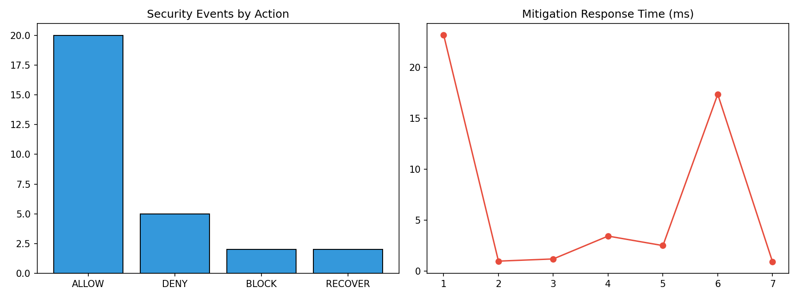

# SDN Dynamic Firewall with Security Event Logger

**Course:** Computer Networks (UE25CS243A)  
**Topic:** Dynamic Firewall with Security Event Logger (SDN + TCP Socket Programming)

---

## 1. System Architecture & 3-Person Work Division

| Team Member | Layer Owned | Files | Responsibilities |
| :--- | :--- | :--- | :--- |
| **Person A** | Network & Traffic Layer | topo.py, server.py, client.py | 4-host OpenFlow 1.3 Mininet topology, multi-threaded TCP server, and multi-mode client/attack generator (normal, forbidden, scan, flood, recovery). |
| **Person B** | SDN Controller Layer | fw_controller.py, policy.json | PacketIn L3/L4 header extraction (src_ip, dst_ip, dst_port), static policy enforcement (ALLOW/DENY), dynamic host-wide BLOCK rule installation, and automatic recovery via EventOFPFlowRemoved. |
| **Person C** | Detection, Logging & Evaluation Layer | detector.py, log_server.py, evaluate.py | 5-second sliding-window anomaly detector (Port Scan & Connection Flood) with escalating block durations (15s -> 30s -> 60s), centralized TCP JSON/CSV SIEM logger, and automated performance plotting. |

---

## 2. How to Reproduce the Demo (3 Terminals)

1. **Terminal 1 (Centralized Logger):**
   python3 log_server.py

2. **Terminal 2 (SDN Firewall Controller):**
   source ~/sdn_venv/bin/activate
   ryu-manager fw_controller.py

3. **Terminal 3 (Mininet Topology & Test Cases):**
   sudo mn -c
   sudo python3 topo.py

   Inside mininet> CLI:
   mininet> h4 python3 server.py 8080 &
   mininet> h1 python3 client.py normal
   mininet> h2 python3 client.py forbidden
   mininet> h3 python3 client.py recovery
   mininet> h3 python3 client.py flood
   mininet> exit

4. **Generate Evaluation Graphs:**
   python3 evaluate.py

---

## 3. Experimental Evaluation Results

